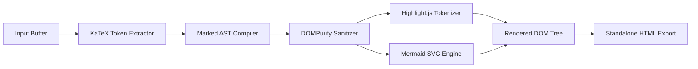

# OmniMark Parser Specification & Reference Document

OmniMark is a client-side Markdown editor and real-time document preview engine. It parses CommonMark and GitHub Flavored Markdown (GFM) in browser memory with zero network dependencies. The compiler evaluates block and inline LaTeX mathematics via KaTeX, compiles diagram DSL into inline SVG vectors via Mermaid.js, tokenizes source code blocks via Highlight.js, and sanitizes output through DOMPurify.

---

## 1. Compiler Architecture & Pipeline Stages

| Pipeline Stage | Engine / Library | Input Format | Output Artifact |
| :--- | :--- | :--- | :--- |
| Lexical & Block Tokenization | Marked.js 12.0.2 | Raw Markdown (`.md`, `.txt`) | HTML5 Semantic AST |
| Mathematical Notation | KaTeX 0.16.10 | TeX / LaTeX (`$...$`, `$$...$$`) | MathML & HTML Spans |
| Code Syntax Tokenization | Highlight.js 11.9.0 | Polyglot source blocks | Scoped token classes |
| Diagram Compilation | Mermaid.js 10.9.1 | Graph / sequence DSL | Inline SVG vector nodes |
| HTML Sanitization | DOMPurify 3.1.2 | Raw compiler output | Safe DOM tree |

---

## 2. Callout Alert Blocks

The parser isolates blockquotes matching `> [!TYPE]` headers and transforms them into semantic alert containers before DOM insertion:

> [!NOTE]
> Background context and reference details for system operation.

> [!TIP]
> Drag and drop any `.md` or `.txt` file onto the editor pane to load its contents into memory via the HTML5 FileReader API.

> [!IMPORTANT]
> DOMPurify sanitizes the parsed HTML tree prior to insertion, stripping script injection vectors while preserving KaTeX MathML structures and Mermaid SVG nodes.

> [!WARNING]
> Unescaped dollar signs within code spans are preserved as literal text. For literal math delimiters in body text, escape with a backslash: `\$`.

> [!CAUTION]
> The editor buffer resides in browser session memory. Use the Export action to download standalone HTML before closing the browser session.

---

## 3. Compiler Pipeline Flowchart

Mermaid code blocks automatically compile into scalable vector graphics in real time:



---

## 4. Syntax Highlighted Code Blocks

Code blocks feature automatic language identification, atom token coloring, and one-click clipboard copying:

```typescript
// Telemetry calculation for reading metrics
interface DocumentMetrics {
  words: number;
  characters: number;
  lines: number;
  estimatedReadTimeMinutes: number;
}

export function computeDocumentMetrics(source: string): DocumentMetrics {
  const characters = source.length;
  const tokens = source.trim() ? source.trim().match(/\S+/g) || [] : [];
  const words = tokens.length;
  const lines = source.split('\n').length;
  const estimatedReadTimeMinutes = Math.max(0.5, Math.ceil(words / 200));

  return {
    words,
    characters,
    lines,
    estimatedReadTimeMinutes,
  };
}
```

```python
import re
from typing import Pattern

# Lexical anchor generator for heading navigation
SLUG_CLEANER: Pattern[str] = re.compile(r"[^\w\s-]")
WHITESPACE_SPLITTER: Pattern[str] = re.compile(r"[\s_-]+")

def slugify(heading_text: str) -> str:
    """Generate a clean URL anchor from raw heading markdown."""
    lowered = heading_text.lower().strip()
    cleaned = SLUG_CLEANER.sub("", lowered)
    slug = WHITESPACE_SPLITTER.sub("-", cleaned)
    return slug.strip("-")

assert slugify("Compiler Architecture & Pipeline") == "compiler-architecture-pipeline"
```

```rust
// In-memory Markdown line-number indexer
pub struct LineCounter {
    pub line_count: usize,
    pub total_bytes: usize,
}

impl LineCounter {
    pub fn from_buffer(buffer: &[u8]) -> Self {
        let lines = buffer.iter().filter(|&&b| b == b'\n').count() + 1;
        Self {
            line_count: lines,
            total_bytes: buffer.len(),
        }
    }
}
```

---

## 5. Mathematical Notation (KaTeX)

Inline and display mathematics are evaluated using the KaTeX rendering engine:

The continuous Fourier Transform of an integrable function $f(x)$ is defined as:

$$
\hat{f}(\xi) = \int_{-\infty}^{\infty} f(x) e^{-2\pi i x \xi} \, dx
$$

The standard normal probability density function with mean $\mu$ and standard deviation $\sigma$:

$$
f(x) = \frac{1}{\sigma \sqrt{2\pi}} \exp\left( -\frac{(x-\mu)^2}{2\sigma^2} \right)
$$

---

## 6. Task Lists & Specification Checklists

- [x] Client-side CommonMark and GitHub Flavored Markdown parser
- [x] KaTeX mathematical formula rendering engine
- [x] Mermaid vector diagram dynamic compiler
- [x] Syntax-highlighted code cards with one-click clipboard copying
- [x] GFM callout alert transformations (`NOTE`, `TIP`, `IMPORTANT`, `WARNING`, `CAUTION`)
- [x] Synchronized editor and preview split scrolling with resizable divider
- [x] DOMPurify HTML security sanitization
- [x] Standalone HTML document export

---

## 7. Keyboard Shortcuts & Editor Conventions

| Action | Shortcut (macOS / Windows) | Behavior |
| :--- | :--- | :--- |
| **Bold** | `Cmd+B` / `Ctrl+B` | Wraps selection in `**` tokens |
| **Italic** | `Cmd+I` / `Ctrl+I` | Wraps selection in `*` tokens |
| **Hyperlink** | `Cmd+K` / `Ctrl+K` | Inserts `[text](url)` markdown pattern |
| **Indentation** | `Tab` | Inserts 2 spaces at current cursor position |

<details>
<summary>Technical Details: GFM Container Support</summary>

The rendering engine parses nested HTML `<details>` and `<summary>` elements according to CommonMark specifications, allowing technical disclosures, changelogs, and supplemental API schemas to be embedded directly within markdown source documents.
</details>
