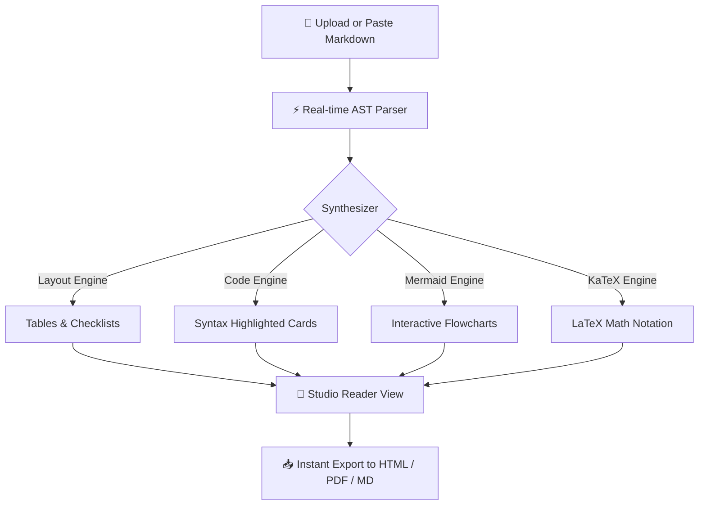

# Welcome to OmniMark 🚀
### Modern Markdown Studio & High-Fidelity Reader

OmniMark is a distraction-free, reactive dual-pane Markdown environment. Upload your `.md` files or paste raw markdown code on the left to immediately inspect the live rendered output on the right.

---

## ⚡ Feature Matrix

| Capability | Standard Mode | Studio Pro Mode | OmniMark Engine |
| :--- | :---: | :---: | :---: |
| **Interactive Callouts** | Regular quotes | `[!NOTE]`, `[!TIP]`, etc. | 💎 Custom accent badges |
| **Code Block Cards** | Plain background | Top bar + 1-Click Copy | ⚡ Highlight.js + line badges |
| **Mermaid Diagrams** | Text block | Vector SVG diagrams | 📊 Real-time SVG rendering |
| **Mathematical Formulas** | Raw LaTeX | KaTeX rendered notation | 🧮 Fast equation engine |
| **Document Outline** | Manual | Interactive TOC Drawer | 📑 Live heading observer |
| **Color Palettes** | Single theme | 5 Curated Studio Themes | 🎨 Obsidian, Navy, Espresso, etc. |

---

## 🔔 Callout Alerts & Notifications

> [!NOTE]
> Useful context and background details that readers can quickly reference.

> [!TIP]
> Helpful advice for productivity. Try dragging and dropping any `.md` file onto the left-hand editor!

> [!IMPORTANT]
> Crucial information readers need to know to complete their tasks.

> [!WARNING]
> Urgent info requiring immediate attention to prevent unintended mistakes.

> [!CAUTION]
> Highlights risk factors or negative outcomes of certain operations.

---

## 🎨 5 Curated Color Themes

OmniMark includes 5 hand-crafted themes accessible from the top toolbar:

1. **Obsidian Dark**: Sleek deep dark mode with crisp borders and azure accents.
2. **Deep Navy**: Rich oceanic navy blue with luminous sapphire and sky blue tones.
3. **Warm Espresso**: Deep charcoal and volcanic stone with warm terracotta accents.
4. **Ivory Parchment**: Clean warm cream paper finish designed for extended reading comfort.
5. **Pure Light**: Minimalist daylight theme with crisp contrast and slate borders.

---

## 📊 Live Interactive Mermaid Diagrams

Any `mermaid` code block automatically renders into a vector graphic in real time:



---

## 💻 Syntax Highlighted Code Cards

Code blocks feature language pills, formatted code, and a 1-click **Copy Code** button:

```javascript
// Reactive document telemetry and live state tracker
class StudioEngine {
  constructor(options = {}) {
    this.theme = options.theme || 'deep-navy';
    this.syncScroll = options.syncScroll ?? true;
  }

  process(markdownSource) {
    console.log(`Processing ${markdownSource.length} characters in ${this.theme} mode...`);
    return marked.parse(markdownSource);
  }
}

const studio = new StudioEngine({ theme: 'deep-navy' });
studio.process('# Welcome to OmniMark');
```

```python
import math
from typing import List, Tuple

def compute_reading_stats(content: str) -> Tuple[int, int, float]:
    """Calculate word count, character count, and estimated reading time (minutes)."""
    words: List[str] = content.split()
    word_count: int = len(words)
    char_count: int = len(content)
    reading_time: float = round(word_count / 200.0, 1) # 200 wpm standard benchmark
    return word_count, char_count, max(reading_time, 0.5)

print(compute_reading_stats("OmniMark provides real-time document telemetry!"))
```

```rust
// Memory-safe parser pipeline
pub struct DocumentStats {
    pub word_count: usize,
    pub reading_time_mins: f32,
}

impl DocumentStats {
    pub fn new(text: &str) -> Self {
        let count = text.split_whitespace().count();
        Self {
            word_count: count,
            reading_time_mins: (count as f32 / 200.0).max(0.5),
        }
    }
}
```

---

## 🧮 KaTeX Mathematical Notation

Render scientific and mathematical formulas effortlessly:

Inline equation: The standard Gaussian distribution is given by $f(x) = \frac{1}{\sigma \sqrt{2\pi}} e^{-\frac{1}{2}\left(\frac{x-\mu}{\sigma}\right)^2}$.

Maxwell's differential equations of classical electromagnetism:

$$
\begin{aligned}
\nabla \cdot \mathbf{E} &= \frac{\rho}{\varepsilon_0} \\
\nabla \cdot \mathbf{B} &= 0 \\
\nabla \times \mathbf{E} &= -\frac{\partial \mathbf{B}}{\partial t} \\
\nabla \times \mathbf{B} &= \mu_0 \left( \mathbf{J} + \varepsilon_0 \frac{\partial \mathbf{E}}{\partial t} \right)
\end{aligned}
$$

---

## ✅ Interactive Checklists & Task Lists

- [x] Responsive dual-pane editor with drag-and-drop file upload
- [x] Modern reader pane with typography and custom scrollbars
- [x] Rich alert callout blocks (`[!NOTE]`, `[!TIP]`, `[!IMPORTANT]`, `[!WARNING]`, `[!CAUTION]`)
- [x] Code blocks with header badges and 1-click copy
- [x] Mathematical formula rendering via KaTeX
- [x] Mermaid diagram vector rendering
- [x] 5 Custom Studio themes including Deep Navy
- [x] Synchronized split scrolling & resizable divider
- [ ] Load your own markdown documents or take notes!

---

## 📌 Typography, Quotes & Details

> "Simplicity is prerequisite for reliability."
> — *Edsger W. Dijkstra*

Keyboard shortcuts supported inside the editor:
- <kbd>Ctrl</kbd> + <kbd>B</kbd> for **Bold**
- <kbd>Ctrl</kbd> + <kbd>I</kbd> for *Italic*
- <kbd>Ctrl</kbd> + <kbd>K</kbd> for [Hyperlink](https://example.com)
- <kbd>Tab</kbd> to insert clean 2-space indentation

<details>
<summary><b>Click to expand Auxiliary Documentation</b></summary>

Inside this collapsible panel, you can place supplementary technical notes, references, or changelogs. OmniMark handles nested markdown and HTML structures seamlessly.
</details>

---

*Enjoy a clean, modern writing and reading experience with OmniMark!*
